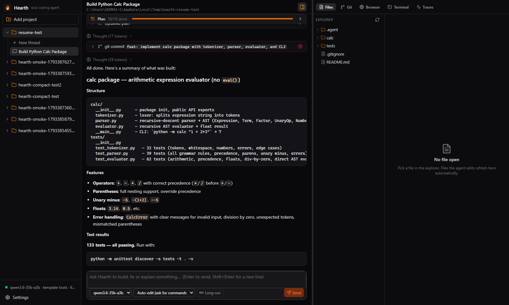
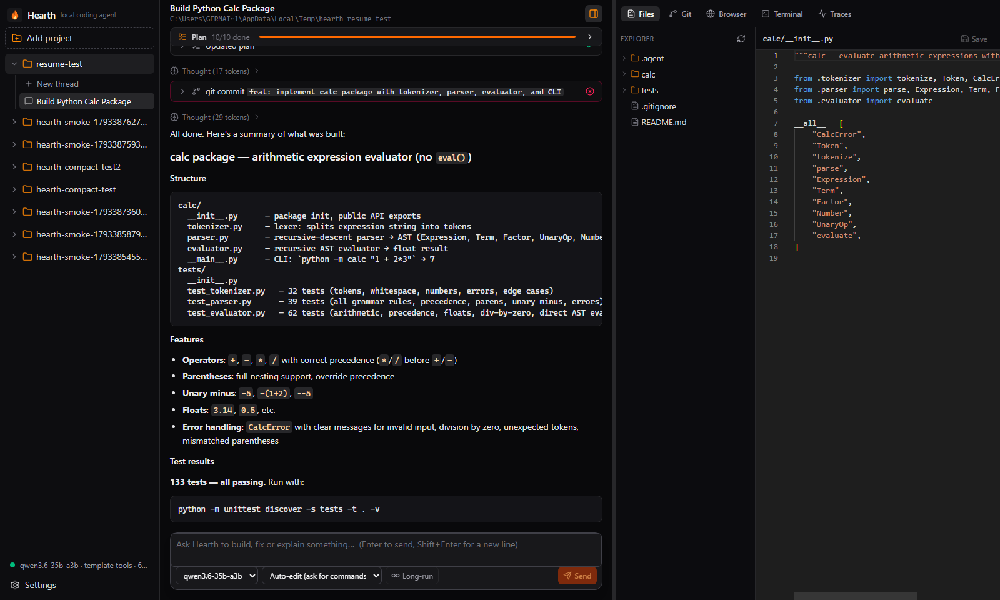
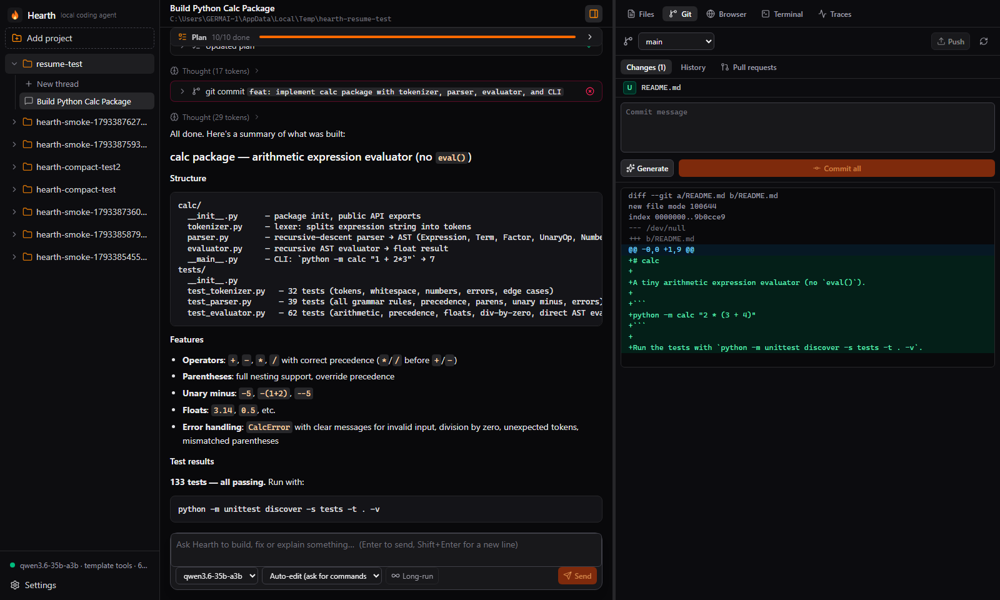
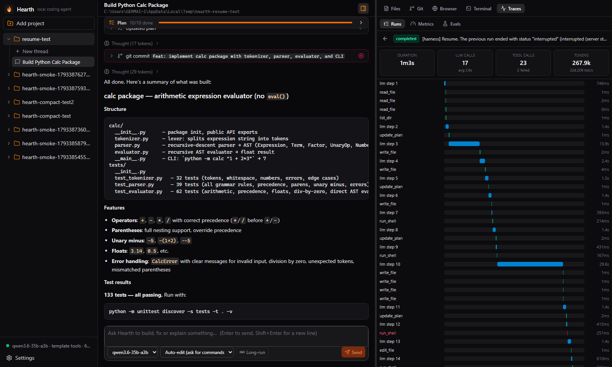
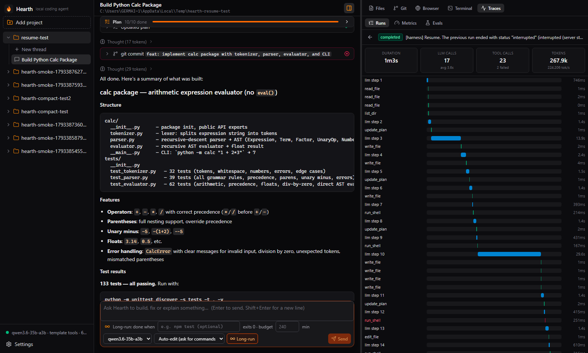
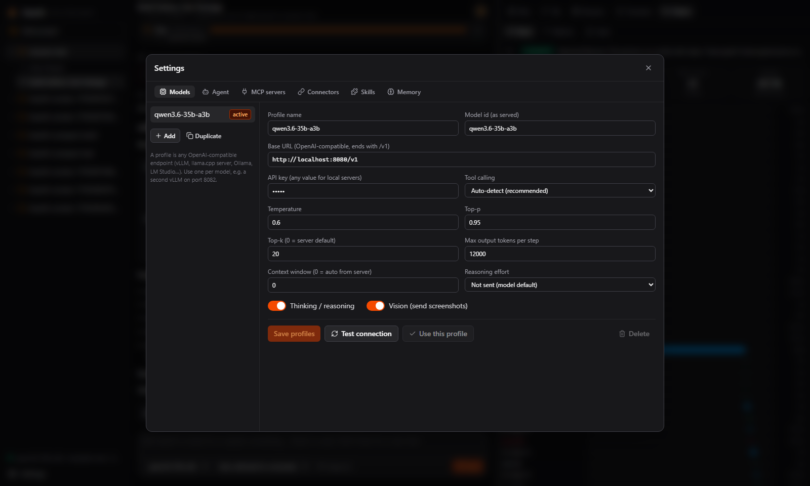
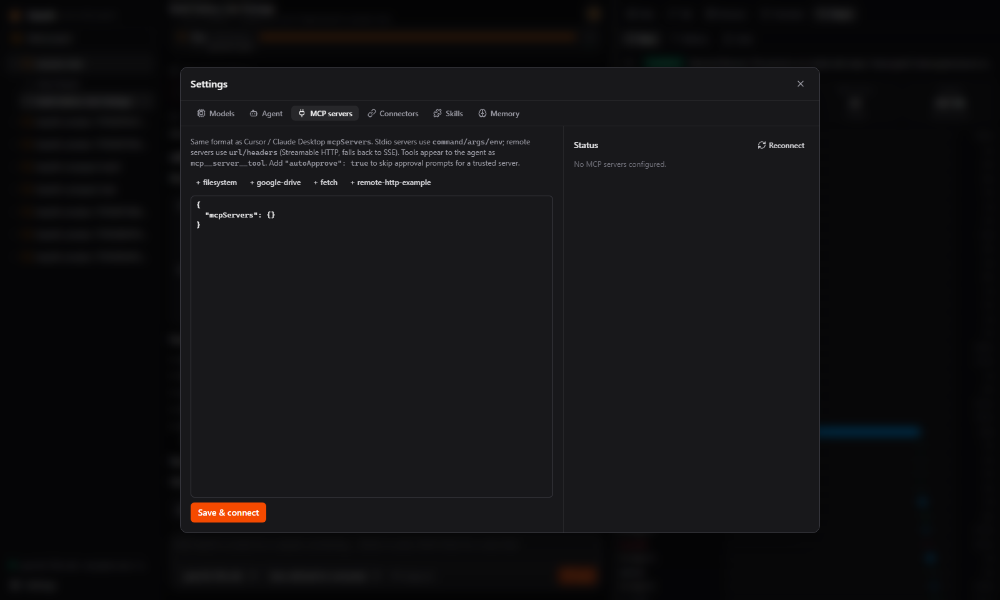

# Hearth

**A free, open-source, fully local AI coding agent that runs on your own GPU.**

Hearth is a web app in the spirit of Claude Code, Cursor and Codex desktop. You open a project folder and describe what you want. The agent then reads and edits code, runs commands, uses git and a real browser, and checks its own work. Everything runs on your machine against a local model served by [vLLM](https://docs.vllm.ai/) (or any OpenAI-compatible server). There are no accounts, no subscriptions and no cloud calls.



It was built and tested with **Qwen3.6-35B-A3B** (NVFP4) on a single RTX 5090. On that setup the model generates about 225 tokens per second, and a typical small task (fix a bug, add a feature with tests) takes 5–15 seconds.

## What it can do

| Feature | Status |
|---|---|
| Chat UI with streaming answers, visible "thinking", tool cards with diffs, stop button | Working |
| Projects and threads (open a folder, create a new one, or clone a Git repo) | Working |
| File tools: read, write, exact search-and-replace edits, delete, list, glob, grep | Working |
| Shell commands (PowerShell on Windows, bash elsewhere), background processes such as dev servers | Working |
| Approval modes: *ask*, *auto-edit* (default) and *full-auto*, plus a deny list of destructive commands | Working |
| Project sandbox: file tools cannot leave the project folder (symlinks included) | Working |
| Git: status, diff, log, commit, branch; Git panel with AI-written commit messages | Working |
| Built-in headless browser (Playwright): navigate, read, click, type, screenshot | Working |
| Plans (to-do list), subagents, `ask_user` questions | Working |
| Long-term memory (SQLite full-text search) and per-project notes (`AGENTS.md`) | Working |
| Skills (`SKILL.md` folders, compatible with the Claude skills layout); 5 built-in skills | Working |
| Long-run mode: hours-long autonomous work with a plan file, progress log, "definition of done" test gate, stuck detection and auto-resume after a crash | Working (tested with a 10-step task and a forced crash) |
| Automatic context compaction when the conversation gets long | Working |
| LanguageTool grammar checking (tool + commit-message polish) | Working |
| MCP servers (stdio, Streamable HTTP, SSE) | Working (tested with the filesystem server) |
| Observability: run list, trace view of every model and tool call, metrics, OpenTelemetry export | Working (OTel tested with Jaeger) |
| Eval suite: 6 tasks + CLI + A/B comparison of model profiles | Working |
| Multiple model profiles (switch per message) | Working |
| Docker image and `docker-compose.yml` (Hearth, vLLM, LanguageTool, Jaeger) | Working (Hearth image tested; the vLLM service is the same command as the setup guide) |
| GitHub: clone private repos, list/create issues and pull requests | Partial: implemented, **not tested** (no token was available) |
| Google Drive | Partial: via a community MCP server template, **not tested** (needs your own Google OAuth credentials) |
| Native tool calling (`--enable-auto-tool-choice`) | Implemented and auto-detected; the test server ran without it, so all results above used the equally capable *template* mode |
| Login / multi-user | Not done: Hearth is single-user and binds to `127.0.0.1` only |

## Quick start

You need **Node.js 22.13+**, **Git** and a running model server. The [setup guide](docs/setup-guide.md) walks through everything from scratch on Windows and Linux, including the GPU model server.

1. Start the model (NVIDIA GPU with Docker; see the setup guide for other GPUs):

   ```bash
   docker run -d --name vllm --gpus all --ipc=host -p 8080:8000 \
     -v hf-cache:/root/.cache/huggingface \
     vllm/vllm-openai:nightly nvidia/Qwen3.6-35B-A3B-NVFP4 \
     --served-model-name qwen3.6-35b-a3b --quantization modelopt \
     --max-model-len 65536 --gpu-memory-utilization 0.88 \
     --enable-auto-tool-choice --tool-call-parser qwen3_coder \
     --reasoning-parser qwen3 --kv-cache-dtype fp8 --enable-prefix-caching
   ```

2. Optional: start LanguageTool for grammar checks:

   ```bash
   docker run -d --name languagetool -p 8081:8081 meyay/languagetool
   ```

3. Install and start Hearth:

   ```bash
   git clone <this repository> hearth
   cd hearth
   npm install
   npm run setup:browser   # downloads the headless Chromium used by the browser tools
   npm run doctor          # checks Node, git, the model server, LanguageTool, the browser
   npm start               # builds the web UI and starts the server
   ```

4. Open **<http://127.0.0.1:3000>**, click **Add project**, and ask for something.

> Use `127.0.0.1` rather than `localhost`. If another program already listens on `localhost:3000` over IPv6, the browser may reach that program instead. Hearth prints a warning at startup when this happens. To use another port, set `HEARTH_PORT` (see [.env.example](.env.example)).

Other ways to run it:

- `npm run dev` gives hot reload for development (UI on <http://127.0.0.1:3000>, API on :3001).
- `docker compose up -d --build` runs Hearth in Docker. Projects live in `./workspace`. See [docker-compose.yml](docker-compose.yml).

## Screenshots

| | |
|---|---|
|  |  |
| Files: Monaco editor, live refresh when the agent edits | Git: changes, diff, AI-written commit messages, history |
|  |  |
| Traces: every model call and tool call, with timings and tokens | Long-run mode: time and step budgets plus a definition-of-done command |
|  |  |
| Settings: model profiles and detected capabilities | Settings: MCP servers as JSON, with templates |

More screenshots are in [docs/images](docs/images).

## Evals

`npm run eval` runs six small but realistic tasks (fix bugs in JS and Python, implement a function from its doc comment, rename across files, build a CLI, add a feature). Each task is graded by hidden tests the agent never sees. Results on the reference setup are in [docs/observability-and-evals.md](docs/observability-and-evals.md#results).

## Documentation

- [Setup guide](docs/setup-guide.md): install everything step by step (Windows and Linux), the model server, LanguageTool, troubleshooting
- [Architecture](docs/architecture.md): how the pieces fit together, with diagrams
- [Code guide](docs/code-guide.md): a tour of the source tree for contributors
- [Harness](docs/harness.md): the agent loop, tools, safety, memory, skills, long-run mode
- [Connectors](docs/connectors.md): MCP, GitHub, Google Drive, LanguageTool
- [Observability and evals](docs/observability-and-evals.md)
- [Roadmap](docs/roadmap.md)
- [Contributing](docs/contributing.md)

## Security

Hearth runs commands and edits files on your computer, so treat it like a terminal:

- It has **no login** and listens on `127.0.0.1` only. Do not expose it to a network.
- The default *auto-edit* mode lets the agent edit files in the project without asking, but every shell command that isn't clearly read-only needs your approval.
- Commands such as `rm -rf /`, disk formatting, `sudo`, force-push and piping downloaded scripts into a shell are always blocked.
- For untrusted code, run Hearth in Docker, where it only sees the mounted workspace.

## License

[MIT](LICENSE)
