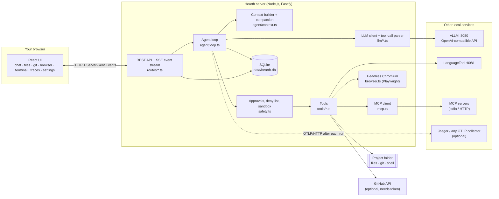
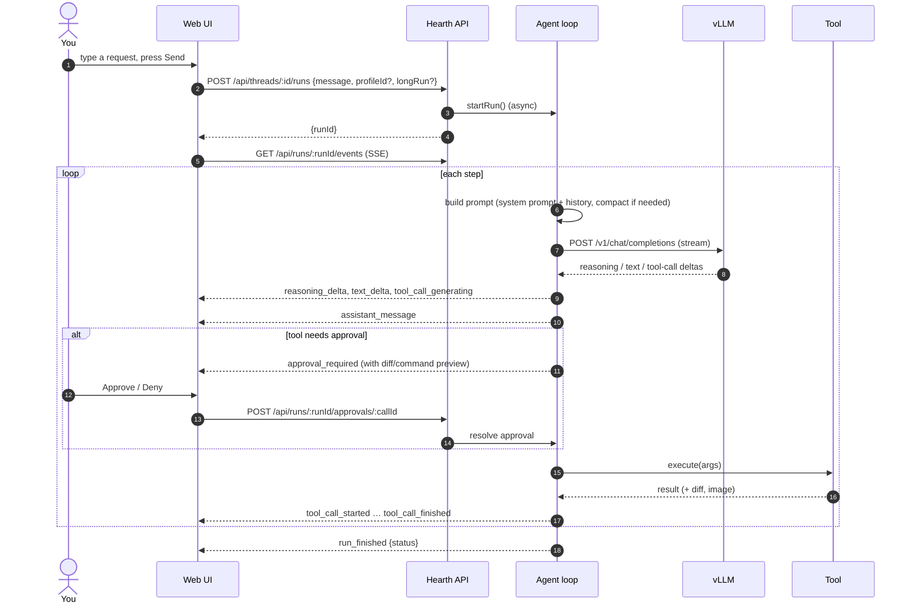
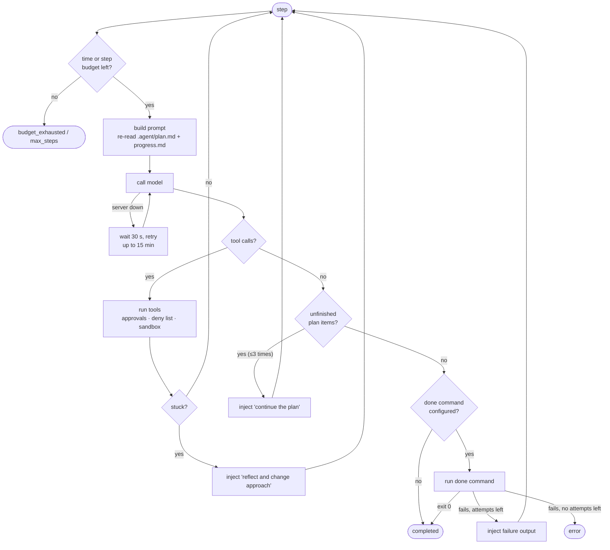
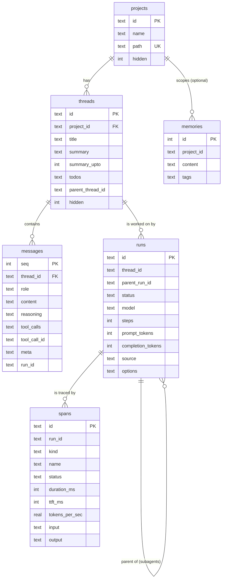

# Architecture

Hearth is one Node.js process that serves a React single-page app and an HTTP API. It runs the agent and talks to a separate model server. Everything runs on your machine.

## Overview

- **The web UI** (`packages/web`) is a static React app. In production the Hearth server serves it from `packages/web/dist`. It never talks to the model directly; everything goes through the API.
- **The server** (`packages/server`) holds all state and does all the work. It is single-user and listens on `localhost:4545` by default (IPv4 and IPv6 loopback).
- **Shared types** (`packages/shared`) define the settings, messages, runs, spans and the `AgentEvent` stream protocol used by both sides.
- **The model server** is anything that speaks the OpenAI Chat Completions API. The reference setup is vLLM serving Qwen3.6-35B-A3B.

## A run, step by step

Every event carries a run-wide sequence number (`seq`). The server keeps the event list of active runs in memory. A browser that reconnects (page reload, second tab) subscribes again and gets the whole list replayed; the UI de-duplicates by sequence number and message ID. API clients can pass `?after=<seq>` to receive only what they missed. Everything durable (messages, runs, spans, plan) is written to SQLite as it happens. A finished conversation is reloaded from `GET /api/threads/:id`.

### Event protocol

The stream is plain Server-Sent Events: one `data: {json}` line per event, plus a `: ping` comment every 15 seconds. The event types (see `AgentEventBody` in `packages/shared/src/index.ts`) are:

| Event | Payload |
|---|---|
| `run_started` | thread, user message, model, long-run options |
| `step_started` | step number |
| `reasoning_delta` / `text_delta` | streamed thinking / answer text |
| `tool_call_generating` | the model has started writing a call to tool *name* |
| `assistant_message` | the stored assistant message, including its tool calls |
| `tool_call_started` / `tool_output_delta` / `tool_call_finished` | tool execution, streamed shell output, stored result message |
| `approval_required` / `approval_resolved` | approval prompt with a preview, and your decision |
| `ask_user` / `ask_user_answered` | a question from the agent, and your answer |
| `plan_updated` | the to-do list |
| `context_compacted` | tokens before and after, plus the summary |
| `usage` | prompt and completion tokens, context limit, tokens per second |
| `verification` | definition-of-done command result (long-run mode) |
| `subagent_event` | an event from a subagent, wrapped with the parent tool call ID |
| `notice` / `error` | informational and warning messages / a fatal error |
| `run_finished` | final status |

## Long-run control flow

When the server restarts, runs that were still `running` are marked `interrupted`. Long-run ones from the last 24 hours are resumed automatically with a harness message that points the agent at its plan and progress files. See [harness.md](harness.md#crash-recovery-and-resume).

## Data model

All state lives in `data/` (override with `HEARTH_DATA_DIR`):

- `data/hearth.db` (SQLite in WAL mode, using Node's built-in `node:sqlite`);
- `data/settings.json`;
- `data/skills/` (your own skills).

Notes on the data model:

- **messages** store the conversation in OpenAI shape (`assistant` messages with `tool_calls`, `tool` messages with `tool_call_id`). The prompt for whatever tool mode is active is rendered from them on every step, so a thread can switch between native, template and prompt mode.
- **threads.summary / summary_upto**: the compaction summary, and the last message sequence number it covers. Older messages stay in the table (and in the UI) but are no longer sent to the model.
- **threads.todos**: the current plan (also mirrored to `.agent/plan.md` in long-run mode).
- **Subagent threads** are hidden child threads (`parent_thread_id`). Their runs point to the parent run.
- **memories_fts** is an FTS5 full-text index kept in sync by triggers.
- **Eval projects** are created as hidden projects, so they don't clutter the sidebar.

## API surface

All endpoints are under `/api` and return JSON. The main groups:

| Area | Endpoints |
|---|---|
| Health and settings | `GET /health`, `GET /capabilities?profileId=&force=`, `GET/PUT /settings` |
| Projects and threads | `GET/POST /projects`, `DELETE /projects/:id`, `GET /browse` (folder picker), `GET/POST /projects/:id/threads`, `GET/DELETE /threads/:id` |
| Runs | `POST /threads/:id/runs`, `POST /threads/:id/resume`, `GET /runs/active`, `GET /runs/:id/events` (SSE), `POST /runs/:id/cancel`, `POST /runs/:id/approvals/:callId`, `POST /runs/:id/answers/:callId` |
| Files | `GET /projects/:id/files`, `GET/PUT /projects/:id/file` |
| Git and GitHub | `GET /projects/:id/git/{status,diff,log,branches}`, `POST /projects/:id/git/{init,commit,checkout,push,discard,generate}`, `GET /github/{me,repos}`, `GET/POST /projects/:id/github/pulls`, `GET /projects/:id/github/issues` |
| Terminal | `POST /projects/:id/terminal` (streams output), `GET /projects/:id/processes`, `GET /processes/:id/output`, `POST /processes/:id/kill` |
| Browser panel | `GET /browser/{info,screenshot}`, `POST /browser/{navigate,click,type,key,scroll,history,close}` |
| Skills, memory, MCP, LanguageTool | `GET /skills`, `GET /skills/:name`, `GET/POST /memories`, `DELETE /memories/:id`, `GET /mcp`, `POST /mcp/reload`, `POST /languagetool/check` |
| Observability and evals | `GET /runs`, `GET /runs/:id/trace`, `GET /metrics`, `GET /evals/tasks`, `GET /evals/reports`, `GET /evals/reports/:id/markdown`, `GET /evals/status`, `POST /evals/run` |

The browser panel and the agent's `browser_*` tools share one headless Chromium. The panel streams screenshots of it, and your clicks and typing go to the same page the agent sees.

## Design choices

- **One process, no build step on the server.** The server runs TypeScript directly with `tsx`, and only the web UI is bundled (Vite). That keeps `npm start` simple and the stack traces readable.
- **SQLite via `node:sqlite`.** No native modules to compile, which matters on Windows. WAL mode and synchronous writes make crash recovery straightforward.
- **The conversation is the source of truth.** The prompt is rebuilt from stored messages each step instead of keeping a mutable in-memory transcript. This is what makes resume, compaction and tool-mode switching simple.
- **Durable task state lives in the project.** Long-run plans and progress are Markdown files in `.agent/`, so they survive anything, are readable by you, and work with git.
- **Capability detection instead of configuration.** Hearth probes the server for context length, tool-calling support and reasoning output. The same install works whether or not vLLM was started with the tool parser.
- **Localhost only, no auth.** Hearth is a personal tool that runs commands on your machine, so it binds to `127.0.0.1` and doesn't pretend to be multi-user. The Docker setup is the way to add isolation.
