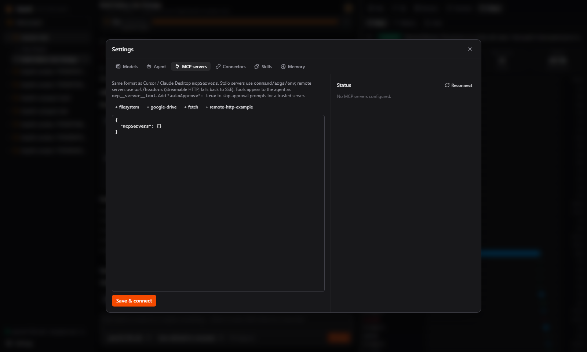

# Connectors

Hearth reaches outside the project folder through four kinds of connectors:

- [**MCP servers**](#mcp-servers): any tool server that speaks the Model Context Protocol;
- [**GitHub**](#github): clone, push, issues, pull requests;
- [**Google Drive**](#google-drive), through an MCP server;
- [**LanguageTool**](#languagetool), the local grammar checker.

All of them are optional, and all are configured in **Settings** in the UI.

| Connector | Status |
|---|---|
| MCP over stdio | Tested (official filesystem server via `npx`: 14 tools listed and used by the agent) |
| MCP over Streamable HTTP / SSE | Implemented, not tested against a live server |
| GitHub | Implemented, **not tested**: no token was available during development |
| Google Drive | Template for a community MCP server, **not tested**: needs your own Google OAuth app |
| LanguageTool | Tested (agent tool, Git panel commit messages, Settings test button) |

## MCP servers

[MCP](https://modelcontextprotocol.io/) servers add tools to the agent: databases, issue trackers, documentation search, other file locations, and so on. Hearth is an MCP *client*. Every tool of every connected server shows up for the model as `mcp__<server>__<tool>`.

### Configure

Open **Settings → MCP servers**. The editor takes the same JSON format as Claude Desktop and Cursor, so you can paste configurations from MCP server READMEs:

```json
{
  "mcpServers": {
    "filesystem": {
      "command": "npx",
      "args": ["-y", "@modelcontextprotocol/server-filesystem", "C:/Users/me/Documents"]
    },
    "fetch": {
      "command": "uvx",
      "args": ["mcp-server-fetch"]
    },
    "my-remote-server": {
      "url": "https://example.com/mcp",
      "headers": { "Authorization": "Bearer <token>" }
    }
  }
}
```



Click **Save & connect**. Hearth (re)connects every server and lists each one with its status, its transport, its tool names, or the error if it failed. The template buttons insert ready-made entries.

Fields per server:

| Field | Meaning |
|---|---|
| `command`, `args`, `env`, `cwd` | Start a local server and talk to it over stdio. `npx`, `uvx`, `node`, `python` and so on all work, on Windows too. |
| `url`, `headers` | Connect to a remote server. Hearth tries Streamable HTTP first and falls back to the older HTTP+SSE transport. |
| `disabled` | Keep the entry but don't connect. |
| `autoApprove` | Run this server's tools without asking (see below). |

### Approvals

MCP tools can do anything (send messages, write to databases), so Hearth treats them as **external** actions. They need your approval in *ask* and *auto-edit* mode, and run freely only in *full-auto*. For a server you trust and that only reads (documentation search, for example), set `"autoApprove": true`.

### Tips

- Each server's tool descriptions take up context. Disable servers you don't need for the current task.
- Local stdio servers run with your user account's permissions. The `filesystem` server, for example, gives the agent access to the folders you list *outside* the project sandbox.
- If a server fails to start, the status list shows the error. Try the same command in a terminal to see its full output.

## GitHub

> **Status: implemented, not tested.** The code paths below exist and type-check, but no GitHub token was available while Hearth was developed, so none of them has run against the real GitHub API. Please report problems.

### Set up

1. Create a token at [github.com/settings/personal-access-tokens](https://github.com/settings/personal-access-tokens) (fine-grained). Give it access to the repositories you want, with these permissions:
   - **Contents**: read and write (clone, push);
   - **Pull requests**: read and write;
   - **Issues**: read and write;
   - **Metadata**: read (added automatically).
2. In Hearth, open **Settings → Connectors → GitHub**, paste the token and click **Save**. Hearth tests it right away and shows the account it belongs to. **Test** repeats the check; **Remove** deletes the token.

You can also set `GITHUB_TOKEN` in `.env` instead. The token is stored in `data/settings.json` on your machine and is never sent to the browser in full (the UI only sees the last four characters).

### What it enables

- **Clone private repositories.** In *Add project → Clone Git repo*, Hearth lists your repositories (with search). `owner/name` shorthand works too.
- **Push.** The Git panel's **Push** button and the agent's `git_push` tool pass the token to git as an HTTP header for `github.com`. It is never written into the remote URL or `.git/config`.
- **Pull requests in the Git panel.** The *Pull requests* tab lists open PRs. Under **New pull request**, **Generate** writes a title and description with the local model, and **Push & open PR** pushes the current branch and opens the PR.
- **Agent tools**:
  - read: `github_list_issues`, `github_get_issue`, `github_list_prs`;
  - write (external, need approval unless in full-auto): `github_create_issue`, `github_create_pr`.

  They work on the repository behind the project's `origin` remote. The issue tools and `github_list_prs` also accept any other `owner/name`. To open a PR, push the branch with `git_push` first.

Without a token, public repositories can still be cloned and ordinary git commands still work. Pushing over HTTPS falls back to whatever credentials your git installation already has.

## Google Drive

> **Status: not tested.** Hearth has no built-in Google Drive code. It offers a template for a community MCP server. Setting it up needs a Google Cloud OAuth app, which is free but takes about 15 minutes. This path has not been tried with real credentials.

Google requires every app that reads your Drive to be registered, so there is no zero-setup option for a local tool. The template uses [`@isaacphi/mcp-gdrive`](https://github.com/isaacphi/mcp-gdrive), which provides tools to search and read Drive files and to read and update Google Sheets.

1. In the [Google Cloud console](https://console.cloud.google.com/), create a project and enable the **Google Drive API** and **Google Sheets API**.
2. Under *APIs & Services → OAuth consent screen*, configure an *External* app in *Testing* mode, and add your Google account as a test user.
3. Under *Credentials*, create an **OAuth client ID** of type *Desktop app*. Note the client ID and client secret.
4. In Hearth, open **Settings → MCP servers** and click the **google-drive** template. Fill in `CLIENT_ID`, `CLIENT_SECRET`, and a folder for `GDRIVE_CREDS_DIR` where the server stores its tokens. Then remove `"disabled": true` and click **Save & connect**.
5. On first use the server prints a Google sign-in link. Follow the server's README for the exact first-run steps; it may be easiest to run its `npx` command once in a terminal to complete the sign-in.

Any other Google Drive MCP server can be configured the same way.

## LanguageTool

[LanguageTool](https://languagetool.org/) is an open-source grammar, style and spelling checker. Hearth expects it on `http://localhost:8081`:

```bash
docker run -d --name languagetool --restart unless-stopped -p 8081:8081 meyay/languagetool
```

Change the URL in **Settings → Connectors → LanguageTool**, where **Test** sends a sample sentence and shows the result.

It is used in three places:

1. **`languagetool_check` tool.** The agent proofreads prose it writes (READMEs, docs, PR descriptions). The `create-readme` and `git-commit-message` skills ask it to.
2. **Git panel → Generate.** The AI-written commit message is checked, and grammar fixes are applied automatically. Spelling suggestions are skipped on purpose, because commit messages are full of identifiers and file names that a spell checker would "correct" (`calc` → `call`). So are fixes that touch code-like text (backticks, paths, `snake_case`).
3. **Settings test**, to check the server is reachable.

If LanguageTool isn't running, the tool reports that to the agent and the Git panel simply skips the polish step.
