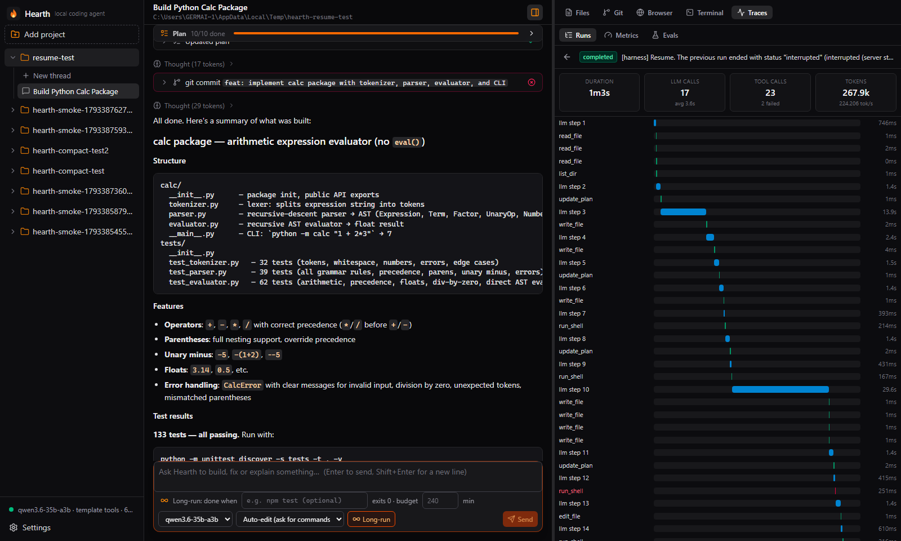

# The agent harness

The "harness" is everything around the model that turns a chat model into a coding agent: the loop, the tools, the safety rules, the context management, memory, skills and long-run mode. All of it lives in `packages/server/src`. This page explains how each piece behaves and why.

- [The agent loop](#the-agent-loop)
- [Tool calling modes](#tool-calling-modes)
- [Tools](#tools)
- [Safety: approvals, deny list, sandbox](#safety-approvals-deny-list-sandbox)
- [Context management and compaction](#context-management-and-compaction)
- [Getting unstuck](#getting-unstuck)
- [Plans, questions and subagents](#plans-questions-and-subagents)
- [Memory and project notes](#memory-and-project-notes)
- [Skills](#skills)
- [Long-run mode](#long-run-mode)
- [Crash recovery and resume](#crash-recovery-and-resume)

## The agent loop

`agent/loop.ts` runs a loop of steps. In each step it:

1. **Builds the prompt** (`agent/context.ts`). The prompt is the system prompt plus the stored conversation, shrunk if needed (see [compaction](#context-management-and-compaction)).
2. **Calls the model** with streaming (`llm/client.ts`). Thinking text, answer text and "the model is writing a tool call" events are forwarded to the browser as they arrive.
3. **Stores the assistant message.** If it contains no tool calls, the run is finished (in long-run mode, only once the [completion gate](#long-run-mode) agrees).
4. **Executes each tool call** in order. For each call it checks the deny list and the approval mode, asks the user if needed, runs the tool, and stores the result. Results longer than 16,000 characters are cut in the middle, keeping the start and the end.
5. **Checks for loops** with the [stuck detector](#getting-unstuck), then starts the next step.

A run ends with one of these statuses:

| Status | Meaning |
|---|---|
| `completed` | The model gave its final answer. |
| `max_steps` | Hit the step limit (default 40; 400 in long-run mode). Send "continue" to go on. |
| `budget_exhausted` | Long-run time budget used up. |
| `cancelled` | You pressed Stop. |
| `error` | The model server failed, the agent was stuck, or the definition-of-done check kept failing. |
| `interrupted` | The server stopped while the run was going (see [crash recovery](#crash-recovery-and-resume)). |

Everything the loop does is sent as a stream of events (`AgentEvent` in `packages/shared/src/index.ts`) to the browser, and recorded as spans for the [Traces panel](observability-and-evals.md).

The **system prompt** (`agent/prompt.ts`) contains:

- the role and environment: OS, shell (with PowerShell syntax hints on Windows), project root, date, approval mode;
- working rules: gather context first, read before editing, verify after changing, don't fabricate;
- the project notes file (`AGENTS.md`);
- up to six long-term memories relevant to the request;
- the list of enabled skills;
- in long-run mode, the long-run rules plus the current `.agent/plan.md` and `.agent/progress.md`.

## Tool calling modes

Models call tools in different ways, and servers support them differently. Hearth has three modes and picks one automatically ("auto", the default). It probes the server when a run starts, and caches the result for 5 minutes.

| Mode | How it works | When it is used |
|---|---|---|
| **native** | Tools are sent as OpenAI `tools` with `tool_choice: "auto"`. The server's tool parser turns the model output into structured `tool_calls`. | vLLM started with `--enable-auto-tool-choice --tool-call-parser …` |
| **template** | Tools are still sent as `tools`, but with `tool_choice: "none"`. The model's own chat template renders them into the prompt, the model writes its usual `<tool_call>` markup as text, and Hearth parses it (`llm/toolparse.ts`, which understands Qwen3-Coder XML and Hermes-style JSON). | Server renders tools but has no tool parser enabled |
| **prompt** | Hearth describes the tools in the system prompt itself and sends tool results back as `<tool_response>` user messages. Works with any chat model. | Server rejects `tools` entirely |

You can force a mode per model profile in Settings → Models. If a native-mode request is rejected mid-run (for example after the server was restarted without the parser), Hearth re-probes and switches modes without failing the run.

In template and prompt mode, Hearth hides tool-call markup from the streamed answer as it arrives (`StreamSplitter`). Calls it can't parse are reported back to the model so it can retry; this happens at most 3 times.

**Evidence:** the six eval tasks pass 6/6 in both template and prompt mode (see [the results](observability-and-evals.md#results)). Native mode is implemented and detected, but the test server ran without the tool parser, so native mode has not been run end to end yet.

## Tools

Each tool is a `ToolDef` (`tools/types.ts`) with a JSON schema, a risk level and an `execute` function. Some tools also have a `preview` that shows a diff in the approval prompt.

| Tool | Risk | What it does |
|---|---|---|
| `read_file` | read | Read a text file with line numbers (`offset`/`limit` for big files) |
| `write_file` | edit | Create or overwrite a file; returns a diff |
| `edit_file` | edit | Exact search-and-replace (unique match or `replace_all`); returns a diff |
| `delete_file` | edit | Delete a file (or an empty folder) in the project |
| `list_dir` | read | Directory tree (skips `node_modules`, `.git`, build output) |
| `glob` | read | Find files by pattern |
| `grep` | read | Regex search across the project, with context lines |
| `run_shell` | shell | Run a command (PowerShell on Windows, bash elsewhere), with a timeout; `background: true` for dev servers |
| `shell_output` / `shell_kill` | read | Read output of, or stop, a background process |
| `git_status` / `git_diff` / `git_log` | read | Inspect the repository |
| `git_commit` | edit | Stage and commit (all changes or given paths) |
| `git_branch` | edit | Create, switch or list branches |
| `git_push` | external | Push the current branch to `origin` |
| `github_list_issues` / `github_get_issue` / `github_list_prs` | network | Read GitHub (token needed) |
| `github_create_issue` / `github_create_pr` | external | Write to GitHub (token needed) |
| `web_fetch` | network | Fetch a URL as Markdown/text |
| `web_search` | network | Search the web (DuckDuckGo HTML, no API key; best effort, as DuckDuckGo may rate-limit) |
| `browser_navigate` / `browser_click` / `browser_type` / `browser_press` | network | Drive the shared headless Chromium |
| `browser_read` / `browser_screenshot` | read | Read the page as text, or take a screenshot (shown to vision models) |
| `languagetool_check` | read | Grammar and spelling check with the local LanguageTool server |
| `update_plan` | read | Write the to-do list shown above the chat (and `.agent/plan.md` in long-run mode) |
| `ask_user` | read | Ask a question (optionally with choices) and wait for the answer |
| `load_skill` | read | Load a skill's full instructions |
| `memory_save` / `memory_search` / `memory_delete` | read | Long-term memory |
| `update_project_notes` | edit | Append to (or replace) the project's `AGENTS.md` |
| `spawn_subagent` | read | Delegate a task to a subagent with a fresh context |
| `mcp__<server>__<tool>` | external | Every tool of every connected [MCP server](connectors.md#mcp-servers) |

## Safety: approvals, deny list, sandbox

`safety.ts` decides what may run.

**Approval modes** (chosen in the composer, default *auto-edit*):

| Risk | ask | auto-edit | full-auto |
|---|---|---|---|
| read, network | run | run | run |
| edit (files in the project, local commits) | **ask** | run | run |
| shell | **ask** | run if read-only (`ls`, `git status`, `cat`, `Get-ChildItem`, …), otherwise **ask** | run |
| external (push, GitHub writes, MCP tools) | **ask** | **ask** | run |

When asked, you can approve, approve this tool for the rest of the run ("Always allow"), or deny with feedback. A denied call is reported to the model as "the user DENIED this call", so it adapts instead of retrying. An MCP server can be marked `"autoApprove": true` if you trust it.

A command only counts as "read-only" if it starts with a known safe command and contains no `;`, `&`, `>`, backticks or `$(` (piping into `head`, `sort`, `grep` and similar is allowed). `find -exec` / `-delete` and branch-changing `git branch` flags don't count as read-only.

**The deny list** blocks commands in every mode, even full-auto:

- recursive force deletes of `/`, `~`, `*`, `..` or a drive root;
- `mkfs`, `fdisk`, `diskpart`, `format C:`, `dd of=/dev/…`;
- fork bombs, shutdown and reboot;
- `git push --force` / `-f` (`--force-with-lease` is allowed, but still needs approval);
- `chmod -R 777 /`, `reg delete`, `bcdedit`, `vssadmin delete`;
- piping a downloaded script into a shell (`curl … | sh`, `iwr … | iex`);
- `sudo`.

**The sandbox.** File tools resolve every path inside the project folder and refuse anything outside it, including through symlinks and junctions. Shell commands run with the project as their working directory, but they are *not* sandboxed: a shell command can touch any file your user account can. That's why shell commands need approval by default. For a hard boundary, run Hearth in Docker (see the [setup guide](setup-guide.md#8-running-hearth-in-docker)), where it only sees `/workspace`.

Unit tests for all of this are in `safety.test.ts`.

## Context management and compaction

The model has a fixed context window (65,536 tokens on the reference setup, detected from the server). `agent/context.ts` keeps each prompt inside it:

1. **Estimate.** Tokens are estimated from characters (about 3.2 characters per token), and the ratio is calibrated against the real prompt token counts the server reports.
2. **Prune.** When the prompt passes the compaction threshold (*Compact at*, default 65% of the window), the bodies of old tool outputs (everything except the last 10 messages) are cut to a short stub first. That alone is often enough.
3. **Compact.** If it's still too big, the older part of the conversation is summarized by the model into a structured checkpoint: goal, constraints, done so far, files touched, key findings and errors, current state, next steps. The most recent whole turns are kept verbatim. A tool result is never separated from its call. The summary replaces the old messages in the prompt (they stay in the database and the UI). In long-run mode the summary is also appended to `.agent/progress.md`.
4. **Last resort.** If the prompt is still over budget, the largest messages are cut in the middle.

If the server still rejects a prompt as too long, Hearth compacts more aggressively and retries, at most twice per step. The chat shows each compaction ("Context compacted: ~41k → ~9k tokens", click it to read the summary) and the Traces panel shows it as a span.

**Tested:** with the context limit forced to 10,000 tokens, a multi-step task compacted its context mid-run and still completed. `context.test.ts` has unit tests for the turn-preserving cut and pruning.

## Getting unstuck

Local models sometimes loop. The stuck detector in `loop.ts` watches for:

- the same failing call 3 times in a row;
- an identical call (same tool, same arguments) 3 times among the last 8;
- 5 failed calls in a row.

When one of these triggers, Hearth adds a harness message telling the model to stop, re-read the errors, list hypotheses and try a genuinely different approach. Outside long-run mode, a run that keeps getting stuck (more than 4 nudges) ends with an error instead of burning steps. Polling tools such as `shell_output` and `git_status` are exempt.

Hearth also nudges the model (up to twice) when it returns an empty answer, for example because its thinking used up all output tokens.

## Plans, questions and subagents

- **`update_plan`** keeps a to-do list. The model is told to plan any multi-step task, with exactly one item in progress. The plan appears above the chat as a collapsible checklist.
- **`ask_user`** pauses the run and shows a question card (with buttons if the model offers choices). Your answer becomes the tool result.
- **`spawn_subagent`** starts a nested agent with a fresh, empty context and the same tools, minus `spawn_subagent`, `ask_user` and `update_plan`. It is read-only by default, and capped at 25 steps. Only its final report returns to the main agent, which keeps the main context small during broad research. Its steps appear nested inside the tool card. Subagents can't start further subagents.

## Memory and project notes

**Long-term memory** is stored in SQLite with a full-text index (FTS5).

- `memory_save` stores a fact: a user preference, how to build a project, a gotcha. Memories are scoped to the current project or global.
- At the start of every run, up to 6 memories matching the request are added to the system prompt. You can turn this off in Settings → Agent.
- `memory_search` and `memory_delete` let the agent manage its memories.
- You can browse, add and delete memories in Settings → Memory.

**Project notes** are a Markdown file in the project root: the first of `AGENTS.md`, `AGENT.md` or `CLAUDE.md` that exists. They are included in every conversation in that project, which makes them the place for build commands, conventions and architecture notes. The agent can append to them with `update_project_notes`, and you can edit them like any file.

## Skills

A skill is a folder with a `SKILL.md` file: YAML frontmatter with `name` and `description`, then Markdown instructions. Other files in the folder (scripts, templates) come along. This is the same layout Claude uses, so existing skills work.

```markdown
---
name: write-tests
description: Write or extend automated tests for existing code. Use when asked to add tests or raise coverage.
---
# Writing tests
1. Find the project's test framework and how tests are run…
```

Only the names and descriptions go into the system prompt. When a task matches, the model calls `load_skill` to read the full instructions, which keeps prompts small.

Skills are loaded from these folders, in this order (later ones override same-named earlier ones):

1. `skills/` in the Hearth folder (built-in): `write-tests`, `code-review`, `debug-failing-test`, `git-commit-message`, `create-readme`;
2. `data/skills/` (your own, for all projects);
3. `.hearth/skills/` and `.claude/skills/` inside a project.

Enable, disable and preview skills in Settings → Skills.

## Long-run mode

Long-run mode is for work that takes many steps: building an app from a spec, a large refactor, getting a test suite green. Turn it on with the **Long-run** button in the composer. You can set:

- a **time budget** (default 240 minutes);
- a **step budget** (default 400);
- a **definition-of-done command**, for example `npm test` or `python -m pytest`;
- **verify attempts** (default 6).

Defaults live in Settings → Agent.



What changes in long-run mode:

- **Durable state in the project.** The agent writes its plan to `.agent/plan.md` and appends notes to `.agent/progress.md` after each milestone. Hearth appends there too: compaction checkpoints, verification results, and how the run ended. Both files are re-read into the system prompt at every step, so the agent can lose its whole conversation to compaction and still know where it is.
- **Completion gate.** When the model tries to finish:
  1. Hearth checks the plan. If items are still pending, it sends the model back to work, up to 3 times. The model can cancel an item with a reason.
  2. Hearth runs the definition-of-done command. If it fails, the output goes back to the model with "fix it and only then finish".
  3. After the allowed number of failed attempts, the run ends with an error rather than looping forever.

  Each verification shows in the chat as a pass or fail card.
- **Patience with the model server.** If vLLM is restarted or briefly fails, the run waits and retries every 30 seconds for up to 15 minutes, instead of failing.
- **Unattended rules.** The system prompt tells the agent not to stop and ask for confirmation, to work in small verified increments, and to commit working milestones.

## Crash recovery and resume

All conversation state is saved to SQLite as it happens. If the Hearth server stops mid-run (crash, reboot, Ctrl+C):

1. On the next start, every run still marked `running` becomes `interrupted`. Tool calls that never got a result are given a placeholder result ("the run was interrupted before this tool finished") when the conversation is next sent to the model, so the conversation stays valid.
2. **Long-run tasks resume automatically** if they were interrupted within the last 24 hours and *Auto-resume* is on (Settings → Agent; on by default). The new run gets a harness message:

   > The previous run ended with status "interrupted". Re-read .agent/plan.md and .agent/progress.md, check the current state of the files, then continue the task where you left off. Do not redo work that is already complete.

   It keeps the original options (budget, done command, model profile).
3. Any other stopped run (interrupted, out of steps, out of time, error) shows a banner with a **Resume** button above the composer that does the same thing.

**Tested:** a 10-item long-run task (a Python expression calculator) was killed mid-run by stopping the server. On restart Hearth logged "Resumed interrupted long-run task". The agent re-read its plan, skipped the finished parts, completed the remaining items, and passed its definition-of-done check with 133 tests.
