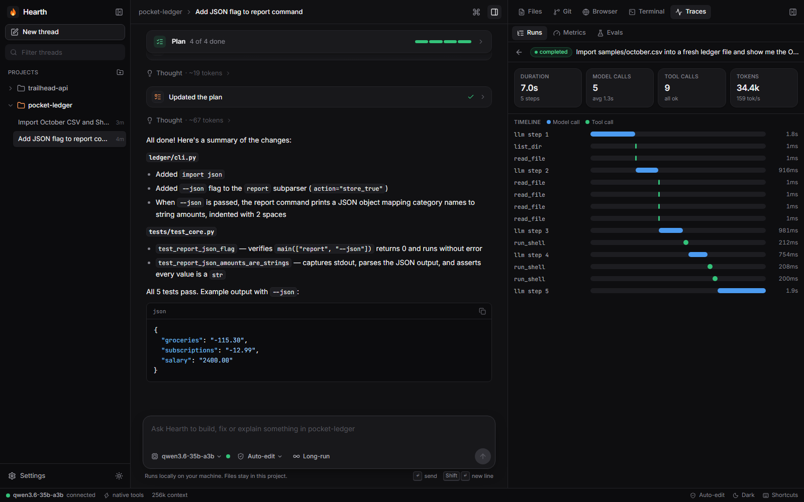
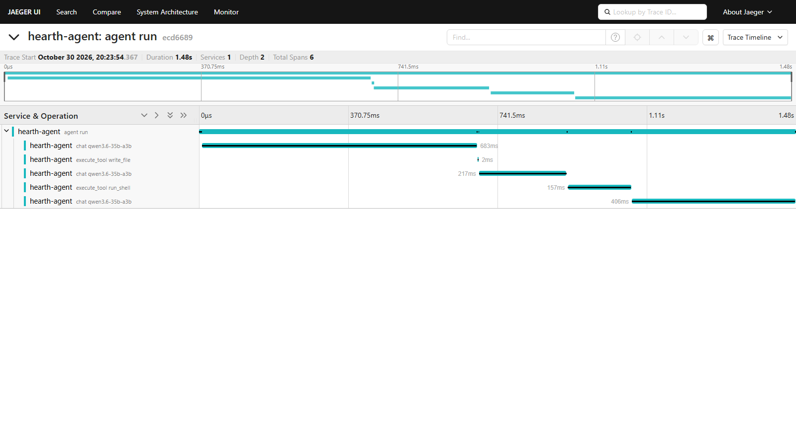

# Observability and evals

Hearth records everything the agent does, so you can see why it behaved the way it did. It also ships an eval suite, so you can measure whether a change (a new model, other sampling settings, a harness tweak) made things better or worse.

- [Traces panel](#traces-panel)
- [Metrics](#metrics)
- [OpenTelemetry export](#opentelemetry-export)
- [Evals](#evals)
- [Results](#results)
- [Writing an eval task](#writing-an-eval-task)
- [A/B testing models and settings](#ab-testing-models-and-settings)

## Traces panel

Open the **Traces** tab in the right panel. **Runs** lists recent runs with their status, duration, steps and tokens. Tick *all projects (incl. evals)* to include other projects and eval runs. Click a run to see its trace:



- The header shows the run's status, duration, number of model calls (with average speed), number of tool calls (with failures), and total tokens.
- The waterfall lists every **span** in time order:
  - **llm step N**: one model call, with time to first token, tokens per second, and prompt and completion tokens;
  - **tool calls**, by tool name, in red if they failed;
  - **approval** waits;
  - **compaction**;
  - **subagent** runs;
  - **verification** (long-run definition-of-done checks).
- Click a span to see its input and output. For model calls that means the size of the prompt, the last message, the reply, the thinking, the parsed tool calls, and any parse errors. For tools it means the arguments and the result.

Spans are stored in SQLite (`spans` table), so traces survive restarts. The raw data is available from `GET /api/runs` and `GET /api/runs/:id/trace`.

## Metrics

**Traces → Metrics** aggregates all runs in a time window (default: the last 7 days):

- runs by status;
- model calls, average tokens per second, average time to first token, average latency;
- total prompt and completion tokens;
- tool calls and the overall tool success rate;
- a per-tool table: calls, errors, average duration;
- a chart of recent model calls (speed and size).

On the reference setup (RTX 5090, Qwen3.6-35B-A3B NVFP4, prefix caching on), the metrics over all development runs (329 model calls) were:

- 225 tokens per second on average;
- 153 ms average time to first token;
- 1.1 s average per model call;
- a 93.5% tool success rate. 21 of the 24 failures were shell commands that exited with a non-zero code, mostly test runs before a fix.

## OpenTelemetry export

Hearth can send each finished run to any OTLP/HTTP collector, such as Jaeger, Grafana Tempo or an OpenTelemetry Collector:

1. Start a collector. The compose file includes Jaeger:

   ```bash
   docker compose --profile observability up -d     # Jaeger UI on http://127.0.0.1:16686, OTLP on :4318
   ```

2. In **Settings → Agent**, turn on *OpenTelemetry export* and set the endpoint (default `http://localhost:4318/v1/traces`). If Hearth runs in Docker, use `http://host.docker.internal:4318/v1/traces`.
3. Run something, then open Jaeger and pick the service **hearth-agent**.

Each run becomes one trace:

- a root span `agent run`, with run ID, status, model, token totals and the user message;
- a child span per model call (`chat <model>`), carrying the `gen_ai.usage.*` token counts, time to first token and tokens per second;
- a child span per tool call (`execute_tool <name>`), carrying its input and output.

Subagent runs join their parent's trace.



**Tested** with `jaegertracing/all-in-one`: a run that wrote and executed a file produced a trace with the agent run, three model calls, and the two tool calls.

## Evals

The eval suite lives in `evals/tasks/`. Each task is a small repository plus a request, graded by **hidden checks** that the agent never sees.

| Task | What the agent must do | Graded by |
|---|---|---|
| `js-fix-bug` | Fix two bugs (rounding, quantity handling) in a small shopping-cart module so the tests pass, without editing the tests | Original tests + hidden tests |
| `py-fix-bug` | Fix an off-by-one and a missing cleanup in a Python inventory class | Original tests + hidden tests (`unittest`) |
| `js-implement-function` | Implement `slugify()` from its doc comment | Hidden tests for the edge cases described in the comment |
| `js-cross-file-rename` | Rename `getUserName` to `getDisplayName` everywhere (code, tests, README) | A script that checks no old name remains + the tests |
| `py-cli-tool` | Write a word-frequency command-line tool from a spec (`--top`, case folding, sorting, error on a missing file) | Hidden `unittest` suite that runs the CLI |
| `js-add-feature` | Add `remove(id)` and a `done` filter to a to-do list class | Hidden tests |

How a task runs (`packages/server/src/evals/runner.ts`):

1. Copy `repo/` to `data/eval-workspaces/<report>/<task>/` and commit it to a fresh git repository.
2. Create a hidden project and run the agent with the task prompt in **full-auto** mode, with the task's step limit and timeout (default 30 steps, 10 minutes).
3. Copy `checks/` over the result. This also **restores the original test files**, so the agent can't pass by editing tests.
4. Run the check commands. The task passes if all of them exit with code 0.

Run it:

```bash
npm run eval                                    # all tasks, active model profile
npm run eval -- --list                          # list tasks and model profiles
npm run eval -- --tasks js-fix-bug,py-fix-bug   # some tasks
npm run eval -- --profile fast --label fast     # another model profile; label goes into the report name
npm run eval -- --no-thinking                   # thinking off
npm run eval -- --tool-mode prompt              # force a tool-calling mode (native | template | prompt)
```

Each run writes `evals/results/<timestamp>[-label].json` and `.md`. The command exits with 0 only if every task passed, so it can gate CI. You can also start evals from **Traces → Evals** in the UI, which lists past reports.

## Results

All on the reference setup: RTX 5090, Windows 11 with PowerShell 5.1. After the vLLM restart, native tool calling is enabled and the context window is 262k tokens.

| Report | Model | Tool mode | Thinking | Score | Total agent time |
|---|---|---|---|---|---|
| [`2026-10-30T19-42-46-native-qwen3.6-pathfix`](../evals/results/2026-10-30T19-42-46-native-qwen3.6-pathfix.md) | Qwen3.6-35B-A3B | **native** | on | **6/6** | 61 s |
| [`2026-10-30T19-46-44-native-qwen3.8-27b`](../evals/results/2026-10-30T19-46-44-native-qwen3.8-27b.md) | Qwen3.8-27B NVFP4 | **native** | on | **6/6** | 391 s |
| [`2026-10-30T19-24-48-final`](../evals/results/2026-10-30T19-24-48-final.md) (before native tools) | Qwen3.6-35B-A3B | template | on | **6/6** | 56 s |
| [`2026-10-30T19-04-39`](../evals/results/2026-10-30T19-04-39.md) | Qwen3.6-35B-A3B | template | on | **6/6** | 61 s |
| [`2026-10-30T19-08-08-prompt-mode`](../evals/results/2026-10-30T19-08-08-prompt-mode.md) | Qwen3.6-35B-A3B | prompt | on | **6/6** | 78 s |
| [`2026-10-30T19-06-46-no-thinking`](../evals/results/2026-10-30T19-06-46-no-thinking.md) | Qwen3.6-35B-A3B | template | **off** | 5/6 | 81 s |

Per task in the final run:

| Task | Result | Time | Steps | Tool calls | Prompt / completion tokens |
|---|---|---|---|---|---|
| js-add-feature | pass | 11.8 s | 12 | 14 | 80,302 / 1,980 |
| js-cross-file-rename | pass | 8.7 s | 11 | 17 | 68,509 / 1,321 |
| js-fix-bug | pass | 6.2 s | 5 | 8 | 33,939 / 885 |
| js-implement-function | pass | 11.4 s | 12 | 12 | 76,957 / 1,924 |
| py-cli-tool | pass | 12.8 s | 7 | 6 | 45,323 / 2,344 |
| py-fix-bug | pass | 4.6 s | 5 | 6 | 29,641 / 682 |

What the comparison shows:

- **Keep Qwen3.6-35B-A3B as the default.** Native tool calling on it matches template mode (6/6 in ~1 minute). Qwen3.8-27B also scored 6/6 but took **6.4× longer** (391 s vs 61 s) because it is a dense 27B model, not a 3B-active mixture of experts.
- **Thinking matters on the open-ended task.** Without thinking, `py-cli-tool` ran out of its 30 steps (318k prompt tokens) on a sort-order detail that the thinking runs got right the first time. Without thinking the other tasks also took more steps (for example 17 instead of 11 for the rename), so it wasn't faster overall either.
- **Prompt mode works as well as template mode** on this model, only a little slower. Hearth is therefore usable with servers that don't support tools at all.
- **The first native-mode run scored 5/6** because the model wrote `py-cli-tool/wordfreq.py` while already inside the `py-cli-tool` folder. Hearth now strips that redundant project-name prefix (see `resolveInProject` in `safety.ts`). After the fix, native mode is 6/6.
- **Six tasks is a smoke test, not a benchmark.** It catches regressions in the harness (parsing, tools, Windows shell handling) and gross model differences, but not small quality differences. Run each configuration more than once before drawing conclusions, since sampling makes individual runs vary.

After these comparisons, the `py-cli-tool` prompt was clarified. It used to say "sort alphabetically" without saying how digits sort; the hidden tests expect plain string order, and the prompt now says so. The three earlier runs used the old wording (the thinking runs passed it anyway), and the final run used the new one.

## Writing an eval task

Create `evals/tasks/<id>/` with:

```text
task.json      the request and how to grade it
repo/          the starting code (copied to a scratch folder; may be empty)
checks/        files copied over the result before grading (hidden tests, original tests)
```

`task.json`:

```json
{
  "title": "Fix an inventory bug without touching the tests (Python)",
  "prompt": "Some unit tests fail. Run them with `python -m unittest discover -s tests -v`, find the bugs in inventory.py and fix them. Do not modify the tests.",
  "check": "{python} -m unittest discover -s tests -v",
  "tags": ["bugfix", "python"],
  "timeoutSec": 600,
  "maxSteps": 30
}
```

- `check` can be a string or an array of commands. They run in the task folder with the platform shell (PowerShell on Windows), and all must exit with 0.
- `{python}` is replaced by `python` or `python3`, whichever exists.
- Make the prompt unambiguous: hidden tests should check what the prompt says, not guess at unstated details.
- Validate the task both ways before committing: the checks must **fail** on the untouched `repo/` and **pass** with a reference solution.

## A/B testing models and settings

1. Add a second profile in **Settings → Models**: another model, another server, or the same model with different settings.
2. Run the suite once per profile, with labels:

   ```bash
   npm run eval -- --profile default --label A
   npm run eval -- --profile candidate --label B
   ```

3. Compare the two Markdown reports in `evals/results/`: score, time, steps and tokens per task.

The same works for harness changes: run the suite before and after your change.
